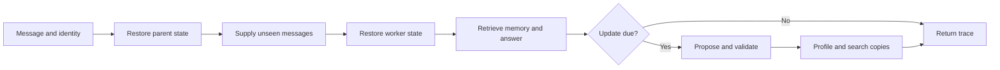

# Persistent memory architecture

The application uses one parent graph and one billing worker graph.
The parent coordinates calls through application code.
The worker generates the answer and retains its own conversation state.
The [verification report](eval-build-status.md) records the current acceptance status.

## Current flow

The parent restores its conversation before adding a message.
It tracks the message identifiers already delivered to the worker.
The worker restores its own history before processing the supplied messages.

The memory service retrieves records from the trusted identity scope.
It includes profile summaries, semantic facts, relevant recorded episodes, and procedural instructions.
OpenAI generates the answer.
When an update is due, a separate OpenAI call proposes memory changes.
The application validates the proposal before saving long-term records.

See [the current Mermaid source](arch-current-memory.mmd).

## Parent and worker boundary

The parent explicitly supplies context to the worker.
The worker also restores its own checkpoint.
A thread identifier does not transfer the parent's transcript.

See [the complete target Mermaid source](arch-target-memory.mmd).
The detailed design separates both checkpoint namespaces from the long-term store.

## Component responsibilities

| Component | Responsibility |
|---|---|
| `app.py` | Retain parent state, prepare worker input, track delivery, and manage memory updates. |
| `worker.py` | Restore worker history, retrieve scoped context, answer, and report supplied versus restored message IDs. |
| `service.py` | Apply memory scope, maintain profiles, and prepare context from profiles, facts, episodes, and procedures. |
| `provider.py` | Call OpenAI for structured answers, structured proposals, and embeddings. |
| `storage.py` | Keep PostgreSQL saver and store connections active for the application lifetime. |
| `cli.py` | Expose conversations, inspection, corrections, deletion, summary, history, branch, and replay controls. |
| `PostgresSaver` | Store conversation checkpoints. |
| `PostgresStore` | Store profiles, semantic copies, episodes, procedures, and vectors. |
| Controlled test provider | Supply predictable proposals for deterministic tests. It does not establish live model behavior. |

## Boundaries

The local operator supplies organization and user identifiers.
The application hashes those identifiers with the conversation identifier for checkpoint selection.
Different users can reuse a visible thread label without sharing a checkpoint.

Private records use `(organization, user, kind)` namespaces.
Shared records use `(organization, _shared, kind)` namespaces.
Model output does not determine access rights.

The profile contains authoritative facts.
Semantic records reference those fact identifiers.
Profile and search writes share a PostgreSQL transaction.
An embedding-failure test verifies rollback through an independent database connection.

The current process retains no database connection after its context manager closes.
Separate-process tests verify parent, worker, profile, episode, procedure, and vector restoration.

## Three-turn example

The comparison fixture supplies only the latest human message.
The worker count includes earlier human and assistant messages.
It excludes the answer currently being generated.

| Turn | Parent supplies | Worker restores | Count before reply |
|---|---|---|---|
| 1 | First human message | No earlier messages | 1 |
| 2 | Second human message | First human message and first answer | 3 |
| 3 | Third human message | Two earlier human messages and two answers | 5 |

A worker first called on turn three has no earlier worker history.
The parent must supply earlier context for that first call.
The late-entry tests verify both cases.

## Update and control rules

The model proposes a patch.
Application code validates and applies it.
Corrections remove specific outdated fact identifiers.
They preserve unrelated preferences in the same category.

Confidence below `0.7` is discarded.
Confidence from `0.7` to below `0.82` creates a proposed fact.
Ordinary retrieval excludes proposed facts.
The confirmed classification applies at `0.82` or higher.
This classification records a confidence rule, not independent verification of truth.

The ordinary schedule runs extraction after five qualifying human messages.
Commands do not advance that counter.
Summary operations preserve the counter and message-delivery hashes.
Profile injection uses the configured chat model's tokenizer.
Its default limit is `2400` tokens.

Fact deletion removes the current profile fact and search copy.
Conversation checkpoints remain available as historical records.
Compaction removes redundant search projections while preserving authoritative facts.
The summary control replaces the parent's active transcript.
The worker retains its separate history.

Forking preserves the original checkpoints.
Replay can execute model calls and memory writes again.
The long-term store does not return to an earlier version automatically.

Checkpoint encryption uses `LANGGRAPH_AES_KEY` from the excluded environment configuration.
The application decodes 64 hexadecimal characters to 32 AES key bytes.
Correct-key and wrong-key tests verify restoration behavior.
This serializer encrypts checkpoint payloads.
It does not encrypt the separate long-term profile store.

The [four-demo guide](guide-four-demos.md) contains runnable commands.

## Glossary

| Term | Meaning |
|---|---|
| Checkpoint | Saved graph state for one scoped conversation. |
| Namespace | A tuple that selects records for an organization, user, and memory kind. |
| Projection | A searchable copy of an authoritative profile fact. |
| Embedding | A numerical representation used for similarity search. |
| Transaction | A database operation group that commits or rolls back together. |
| Stable message ID | An identifier used to prevent duplicate messages during repeated delivery. |
| Proposed fact | Candidate memory excluded from ordinary retrieval. |
| Fixture | Controlled input or output used for a repeatable test. |

Technical meaning and terminology were reviewed.
Full ASD-STE100 dictionary review remains incomplete.
